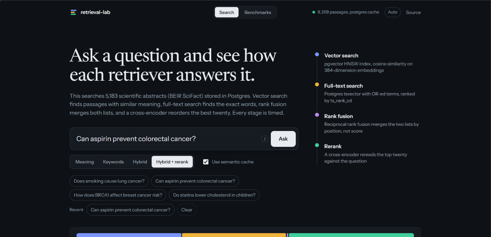
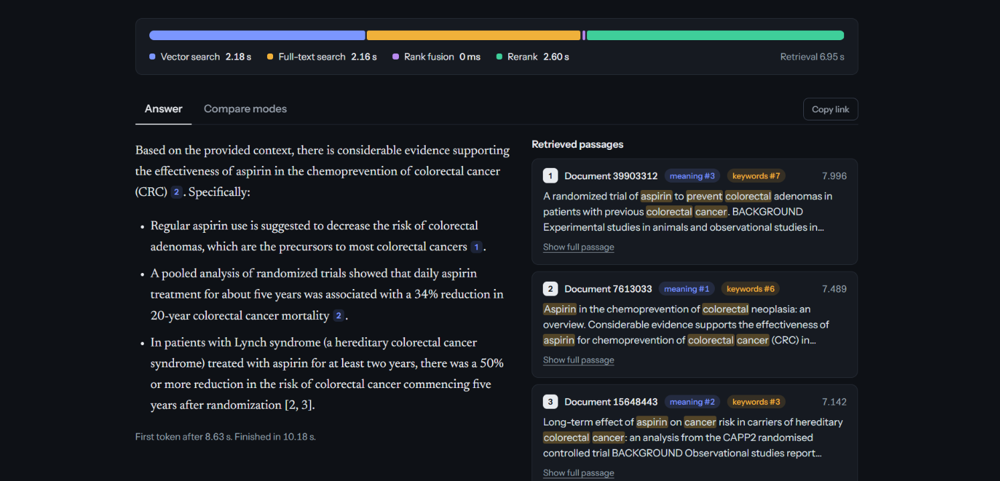

# retrieval-lab

[](https://github.com/hemanthkumar1012/retrieval-lab/actions/workflows/ci.yml)

A retrieval-augmented generation service where the retrieval side is measured, not assumed.
Hybrid search over Postgres (pgvector + full-text), cross-encoder reranking, a semantic
cache, and streamed answers over SSE. Benchmark scripts compare chunking strategies and
retrieval modes on BEIR SciFact and help pick a safe cache threshold.

**Live demo: https://retrieval-lab1.vercel.app** (5,183 SciFact abstracts). Ask a question, watch
each stage's time, then open *Compare modes* to see how meaning search, keyword search, fusion
and reranking order the same results. The *Benchmarks* page charts the measured results below,
including a draggable view of the semantic cache trade-off. Questions have shareable links
(`/?q=...&mode=hybrid`), and keys `/` and `1` to `4` focus the search box and pick a mode.

**Web search:** tick *Also search the web* to combine the knowledge base with live web results. The
model writes one cited summary and says where the two disagree. It uses Tavily when `TAVILY_API_KEY`
is set (free tier) and Wikipedia otherwise. Web answers skip the semantic cache.




## Stack

Python 3.12, FastAPI, Postgres + pgvector 0.8 (HNSW) on Supabase, ONNX Runtime with int8
models (no PyTorch at runtime), deployed as one Vercel function. The semantic cache and the
rate limiter live in the same Postgres database; with `REDIS_URL` set they use Redis instead
(that is what `docker compose` does). The front end is plain HTML, CSS and JavaScript served by
the API, no build step. It is a few small ES modules (`app/static/*.js`) and hand-drawn SVG charts.

## How retrieval works

1. **Dense**: `bge-small-en-v1.5` embeddings (int8 ONNX), cosine distance through an HNSW index.
2. **Lexical**: Postgres full-text search, query terms OR-ed together and ranked with
   `ts_rank_cd`. This is BM25-like but not literally BM25 (no IDF term in `ts_rank_cd`).
3. **Fusion**: reciprocal rank fusion over the two candidate lists (k=60).
4. **Rerank**: `ms-marco-MiniLM-L-6-v2` cross-encoder (int8 ONNX) over the fused top 20.

Chunking strategies (`fixed_128/256/512`, `sentence_256`, `recursive_256/512`) are stored
side by side in the `chunks` table, keyed by a `strategy` column, so they can be compared
on identical data. See [docs/architecture.md](docs/architecture.md) for the design notes.

## Quick start

```bash
cp .env.example .env          # set LLM_API_KEY if you want generated answers
make up                       # postgres + redis
pip install -r requirements.txt
make bench-quick              # ~100 queries, two chunking strategies
```

Then run the API and open http://localhost:8000 for a small streaming demo page
(ingest a corpus first with `python -m app.ingest docs.jsonl`, or run the benchmark, which ingests SciFact):

```bash
make run
curl -X POST localhost:8000/search -H 'content-type: application/json' \
  -d '{"query": "does vitamin D reduce fracture risk", "mode": "hybrid_rerank"}'
curl -N -X POST localhost:8000/ask -H 'content-type: application/json' \
  -d '{"query": "does vitamin D reduce fracture risk"}'
```

`/ask` streams `meta` (sources, per-stage timings, cache hit or miss), then `token`
events, then `done`. Any OpenAI-compatible endpoint works through `LLM_BASE_URL`.
Everything also runs in Docker: `docker compose up --build`.

The models ship in `models/` as int8 ONNX files (56 MB). `scripts/export_models.py` rebuilds them
from the original weights and writes `models/PARITY.md`, which compares them with the PyTorch
versions. Run it from the **export-models** workflow, not on every push.

## Benchmarks

```bash
make bench          # all strategies x all retrieval modes -> bench/results/scifact.md
make cache-bench    # threshold sweep for the semantic cache -> bench/results/cache.md
```

Reported per configuration: recall@1/5/10, MRR@10, nDCG@10 and p50/p95 latency
(query embedding included). Chunk hits are collapsed to documents before scoring,
because SciFact labels are per document. To get enough chunks for that, the reranked mode
reranks the top 40 fused chunks here while the API reranks 20, so its latency is a little higher.

### Results

BEIR SciFact test, all 300 queries, int8 ONNX models, run by the **bench** workflow on a GitHub
runner (two shared CPU cores, so treat latency as an upper bound; the database was local to it).
Equal fusion weights, before any tuning:

| chunking | retrieval | R@1 | R@5 | R@10 | MRR@10 | nDCG@10 | p50 ms | p95 ms |
|---|---|---|---|---|---|---|---|---|
| recursive_256 | dense | 0.570 | 0.737 | 0.803 | 0.669 | 0.695 | 6 | 8 |
| recursive_256 | bm25 | 0.273 | 0.495 | 0.582 | 0.379 | 0.426 | 53 | 140 |
| recursive_256 | hybrid | 0.464 | 0.700 | 0.751 | 0.582 | 0.617 | 60 | 151 |
| recursive_256 | hybrid_rerank | 0.573 | 0.776 | 0.828 | 0.676 | 0.707 | 778 | 1012 |
| fixed_256 | dense | 0.579 | 0.751 | 0.805 | 0.678 | 0.702 | 6 | 8 |
| fixed_256 | bm25 | 0.268 | 0.511 | 0.579 | 0.378 | 0.424 | 49 | 137 |
| fixed_256 | hybrid | 0.483 | 0.705 | 0.759 | 0.598 | 0.631 | 60 | 151 |
| fixed_256 | hybrid_rerank | 0.553 | 0.765 | 0.825 | 0.663 | 0.698 | 885 | 1175 |
| sentence_256 | dense | 0.547 | 0.747 | 0.808 | 0.656 | 0.687 | 6 | 8 |
| sentence_256 | bm25 | 0.293 | 0.509 | 0.584 | 0.396 | 0.438 | 56 | 145 |
| sentence_256 | hybrid | 0.487 | 0.683 | 0.755 | 0.593 | 0.626 | 67 | 157 |
| sentence_256 | hybrid_rerank | 0.565 | 0.769 | 0.825 | 0.674 | 0.704 | 883 | 1292 |

Then a second run swept the weight of the full-text list in rank fusion (`recursive_256`,
the vector list always has weight 1). Dense and bm25 rows are repeated for reference; run to run
the numbers move by about 0.005.

| retrieval | lexical weight | R@1 | R@5 | R@10 | MRR@10 | nDCG@10 | p50 ms |
|---|---|---|---|---|---|---|---|
| dense | | 0.571 | 0.745 | 0.816 | 0.672 | 0.700 | 10 |
| bm25 | | 0.273 | 0.495 | 0.582 | 0.379 | 0.426 | 60 |
| hybrid | 1 | 0.474 | 0.713 | 0.757 | 0.593 | 0.627 | 85 |
| hybrid | 0.5 | 0.507 | 0.730 | 0.779 | 0.626 | 0.656 | 86 |
| hybrid | 0.25 | 0.528 | 0.743 | 0.805 | 0.644 | 0.678 | 87 |
| hybrid | 0.1 | 0.576 | 0.762 | 0.818 | 0.677 | 0.705 | 86 |
| hybrid_rerank | 1 | 0.567 | 0.771 | 0.826 | 0.670 | 0.703 | 1407 |
| hybrid_rerank | 0.5 | 0.570 | 0.766 | 0.816 | 0.665 | 0.698 | 1385 |
| hybrid_rerank | 0.25 | 0.567 | 0.760 | 0.817 | 0.664 | 0.697 | 1387 |
| hybrid_rerank | 0.1 | 0.573 | 0.755 | 0.816 | 0.668 | 0.700 | 1398 |

What this says:

- **Vector search is the strong retriever here.** nDCG@10 is about 0.70 with the int8 model, close to
  the published figure for the full-precision bge-small on SciFact, so quantisation costs little.
- **The Postgres full-text stage is weak** (nDCG 0.43). `ts_rank_cd` has no inverse document
  frequency, so common words count as much as rare ones. Real BM25 scores around 0.67 on this
  dataset. With equal weights it drags fusion below vector search alone (0.627 against 0.700).
- **Turning its weight down fixes that, but it never beats vectors by much.** At 0.1 hybrid reaches
  0.705, a tie with dense within run-to-run noise, so the default is `LEXICAL_WEIGHT=0.1`. In
  practice the full-text list now acts as a tie-breaker. A real BM25 stage is the next thing to try.
- **The reranker helps recall, not ranking quality.** It lifts recall@5 from 0.745 to 0.77 (about
  two points) and leaves nDCG@10 flat at about 0.70, for 1 to 1.4 seconds on two shared cores. It also
  makes the fusion weight irrelevant, because it reorders the top candidates anyway. Whether that is
  worth the latency depends on the use. On this dataset it is a small gain.
- Chunking strategy matters much less than the retrieval mode.

## Semantic cache

Query embeddings are compared against recent cached queries (same strategy and mode).
Above `CACHE_THRESHOLD` cosine similarity the stored answer is replayed. In Postgres the lookup
is a pgvector distance query over at most 2000 entries; the Redis backend scans them in Python.
`make cache-bench` shows the trade-off: how many rephrasings hit, versus how often a
different question wrongly hits. Measured on SciFact claims (hard, since the questions are all
biomedical and similar):

| threshold | paraphrase hit | distinct question wrongly hits |
|---|---|---|
| 0.92 | 100.0% | 12.3% |
| 0.94 | 99.6% | 10.7% |
| 0.96 | 96.2% | 6.0% |
| 0.98 | 55.9% | 2.7% |
| 0.99 | 9.2% | 0.0% |

The default is 0.96: nearly all paraphrases still hit, and the wrong-answer rate is half of what
0.92 gives. Raise it if a wrong cached answer is worse than a slow one.

## Development

```bash
pip install -r requirements-dev.txt
make lint
make test
```

Unit tests cover rank fusion, the evaluation metrics, the chunkers, the rate limiter and the
dependency lists, and need no database. `make smoke` ingests three documents into a running API and checks every
retrieval mode and the streaming endpoint (it adds three `smoke-*` documents to the
`fixed_128` strategy). `make test-sql` runs the retrieval SQL against a real pgvector (CI does the
same in a service container). CI runs lint, unit tests, the SQL tests, and the smoke test against
the full docker compose stack.

## Deploy

Supabase holds the data and Vercel runs the API. Both free plans are enough. Step by step, with
the environment variables, in [docs/deploy.md](docs/deploy.md). Set `ADMIN_TOKEN` on anything
public. Pushing to `main` redeploys, and the free Vercel plan limits how many deployments a day
you get, so batch changes into fewer pushes.

## Layout

```
app/        service: chunking, embeddings, fusion, retrieval, cache, llm, api
app/static/ the web page (index.html, styles.css, app.js)
models/     int8 ONNX embedder and reranker, plus the parity report
bench/      metrics, retrieval benchmark, cache threshold benchmark, SciFact loader
scripts/    model export, smoke test
tests/      unit and SQL tests
sql/        schema
docs/       architecture notes, deploy guide
```

## License

MIT
