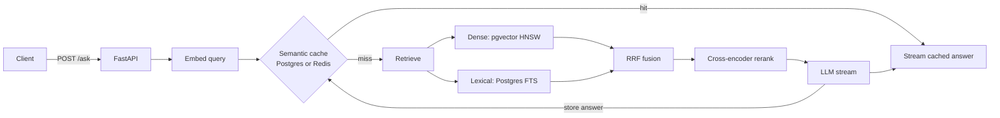

# Architecture

## Decisions worth knowing about

**Postgres for both retrievers.** One database holds vectors and the full-text
index, so a chunk is written once and there is no second system to keep in sync.
The cost is that `ts_rank_cd` is not BM25. If lexical quality turns out to matter,
the lexical stage is one function (`lexical_search`) and can be swapped out.

**Rank fusion, not score fusion.** Cosine similarity and `ts_rank_cd` live on
unrelated scales. Reciprocal rank fusion needs no calibration and has a single
constant (k=60).

**OR-ed lexical query.** `plainto_tsquery` ANDs every term, so a long natural-language
question matches almost nothing. Terms are OR-ed and ranked instead.

**Iterative HNSW scans.** All strategies share one HNSW index and pgvector applies the
`strategy` filter after the index scan. Without iterative scans a query for 40 chunks
returns only the ones among the ~40 nearest *across all strategies* that match, a fraction of
what was asked, and dense recall in the benchmark would be understated for every
configuration. `dense_search_vec` turns on `hnsw.iterative_scan` per transaction (needs
pgvector 0.8+), and `tests/test_sql_integration.py` guards it in CI.

**Strategy column on `chunks`.** Several chunkings of the same corpus coexist, which
is what lets the benchmark compare them on identical data without re-creating tables.

**Doc-level evaluation.** SciFact relevance labels are per document, but retrieval is per
chunk. The benchmark collapses chunk hits to documents (first occurrence wins) before
computing recall, MRR and nDCG.

**One database for everything.** The semantic cache and the rate-limit counters are plain tables
next to the documents (`semantic_cache`, `rate_limits`), so the live demo needs no Redis. Redis
stays supported through `REDIS_URL`; `app/cache.py` picks the backend at startup.

**Semantic cache scope.** Entries are keyed by chunking strategy and retrieval mode as well
as by query embedding, so changing the retrieval configuration never serves a stale answer
from a different one. Lookup is a linear scan over at most 2000 entries; beyond that it
should become an ANN index.

**Latency accounting.** Every retrieval returns per-stage timings (dense, lexical, fusion,
rerank). The benchmark reports p50/p95 of the total, and `/search` and `/ask` expose the
breakdown so regressions can be pinned to a stage.

## Failure modes

- No `LLM_API_KEY`: `/ask` still returns retrieved sources and a notice instead of failing.
  Nothing is written to the cache in that case.
- Cache entries expire after `CACHE_TTL_SECONDS`, and every write trims the cache to the newest
  2000 entries.
- Re-ingesting a document replaces its chunks for that strategy only.

## Known limitations

- Chunk sizes are counted in `cl100k_base` tokens, but `bge-small` and the cross-encoder
  truncate at 512 *wordpiece* tokens, which is usually a larger count for scientific text.
  The 512-token strategies can therefore be cut short at embedding time. Most SciFact
  abstracts are shorter than that, so the effect is small there, but it is not zero.
- The benchmark reranks the top 40 fused chunks (it needs 40 to end with 10 documents), the API
  reranks 20. Latency numbers from `make bench` describe the former.
- The models are int8-quantised. `models/PARITY.md` shows vectors stay close to the originals
  (cosine 0.98), but only the SciFact benchmark says what that costs in recall.
- The rate limiter is a fixed window per client IP and fails open if the cache database is down.
- On a serverless host the first request after idle pays for loading the models.
- `ts_rank_cd` is not BM25, so the `bm25` mode label is shorthand for "Postgres full-text".
